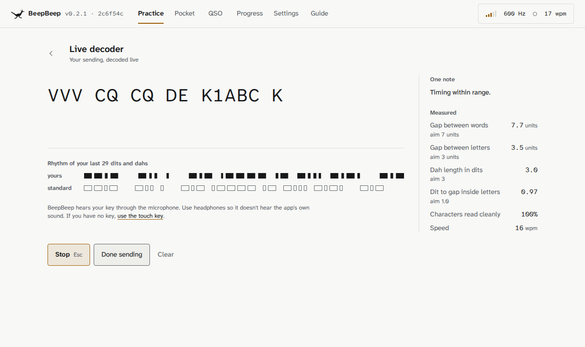
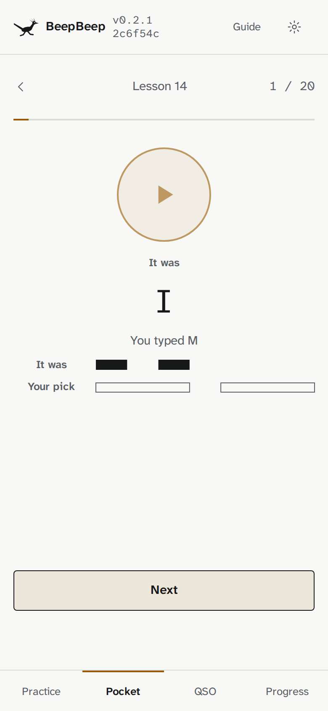
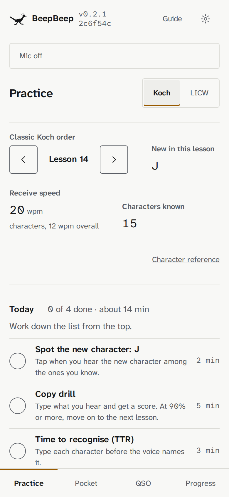
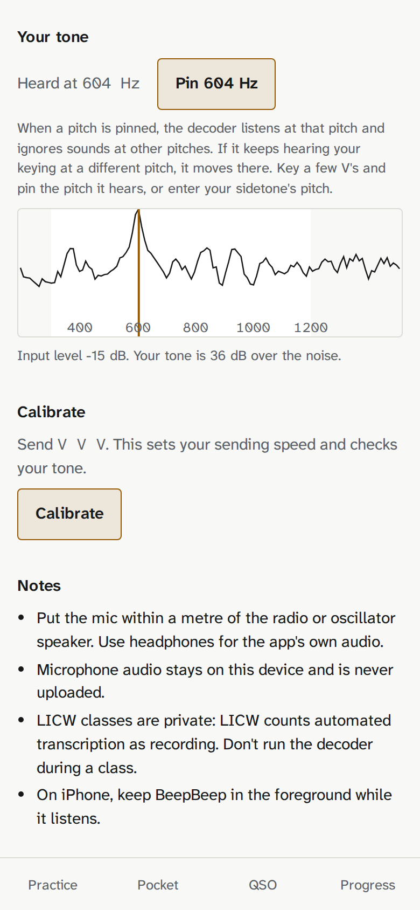
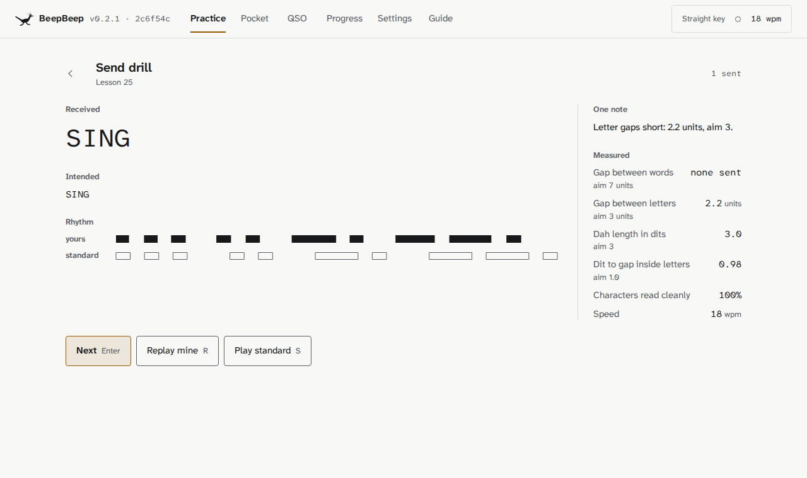
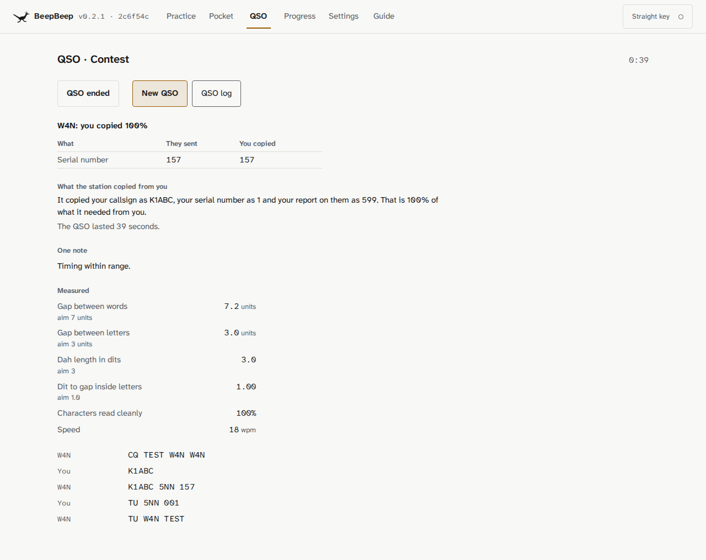
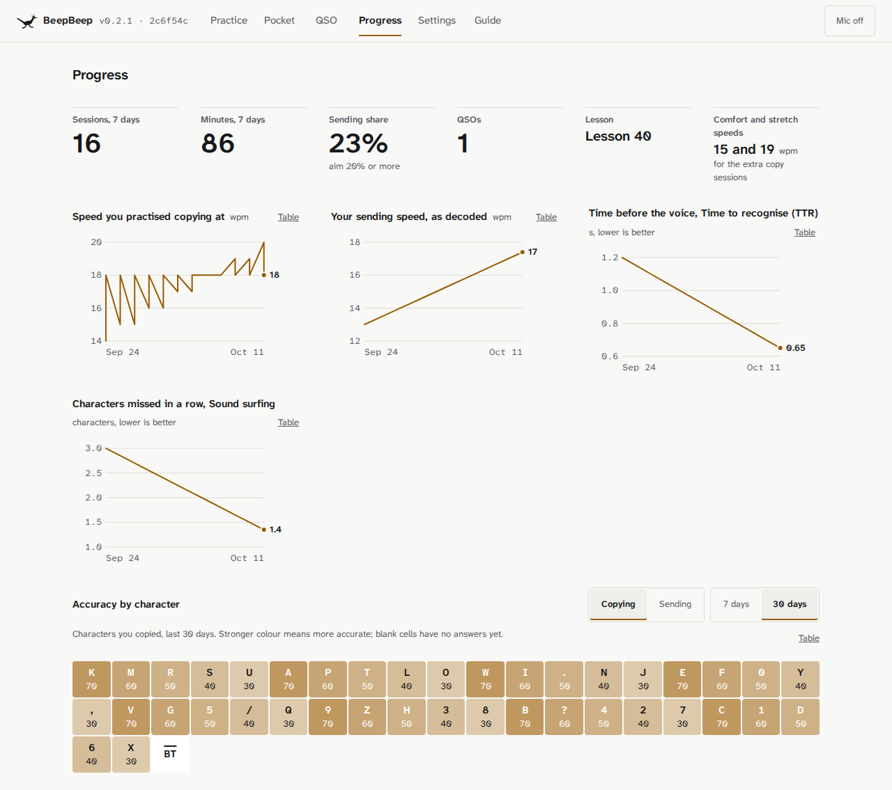

# BeepBeep

BeepBeep is a CW trainer for the browser. It decodes your keying from the microphone, so it works with any sidetone source, such as a transceiver or a practice oscillator.

**https://nnamon.github.io/beepbeep/** · [What's new](CHANGELOG.md)

Runs in desktop and phone browsers (Safari on iOS 16.4+, current Chrome on Android). It can be installed as an app and works offline. Progress is stored in the browser.

<picture><source media="(prefers-color-scheme: dark)" srcset="docs/images/live-decoder-dark.png"></picture>

Live decoder: a recording of simulated hand keying, with a fan and someone talking in the room, plays into the app as its microphone.

<table>
<tr>
<td width="33%"><picture><source media="(prefers-color-scheme: dark)" srcset="docs/images/phone-pocket-dark.png"></picture></td>
<td width="33%"><picture><source media="(prefers-color-scheme: dark)" srcset="docs/images/phone-practice-dark.png"></picture></td>
<td width="33%"><picture><source media="(prefers-color-scheme: dark)" srcset="docs/images/phone-setup-dark.png"></picture></td>
</tr>
<tr>
<td>Pocket: quiz rounds by ear on a phone. After a miss you hear the right answer, then yours.</td>
<td>Practice: your lesson, and today's checklist in the order to work through it.</td>
<td>Setup: BeepBeep finds your tone among the other sounds in the room.</td>
</tr>
</table>

<table>
<tr>
<td width="50%"><picture><source media="(prefers-color-scheme: dark)" srcset="docs/images/send-drill-dark.png"></picture></td>
<td width="50%"><picture><source media="(prefers-color-scheme: dark)" srcset="docs/images/qso-dark.png"></picture></td>
</tr>
<tr>
<td>Send drill: what BeepBeep received, and your rhythm drawn above the standard one. One note names the most important thing to change in your timing.</td>
<td>QSO simulator: you make a contest contact with a simulated station, then see what each side copied.</td>
</tr>
</table>

<picture><source media="(prefers-color-scheme: dark)" srcset="docs/images/progress-dark.png"></picture>

Progress: your speeds over time, and how accurately you copy each character.

## Features

| Area | Modes |
| --- | --- |
| Send | Live decoder, send drill (received text first, then one note on your timing) |
| Both | Hear it, send it; QSO simulator |
| Receive | Copy drill, Spot the new character, Time to recognise (TTR), Sound surfing, Head copy, Callsign and word sprint |
| Pocket | Phone quiz rounds by ear: characters, chunks, words, callsigns, phrases, custom sets |
| QSO | Learn QSOs: guided lessons on each part of a contact, typed or keyed, with each step checked. The QSO simulator: a ragchew (a chat), the LICW QSO protocol, SKCC, K1USN SST, POTA and SOTA (stations in parks and on summits), a contest and a DX pileup |
| LICW exercises | The syllabus exercises for BC1 to BC3, INT 1 to 3, ADV 1 to 3, TTR+ and OverLearn: familiarity, recognition, TTR, VET and VST, groups, Speed Racing, CW-voice-CW and more, at each stage's speeds, with notes on how to do each one |

Practice opens with today's session: a checklist for your lesson, worked from the top and sized to your session length. Steps tick themselves as you do them.

Two course tracks: the classic Koch order (K M R S U…) and the LICW Beginners Carousel (BC1, BC2). Students in an LICW class can start the carousel at the lesson they joined at. LICW strict mode follows the LICW Method Guide: no rhythm bars or character reference, your sending shown only when you finish, receive answers at the end of a drill, and the straight key in BC lessons.

The LICW exercises are for students and for anyone following the syllabus alone. They play material generated from your lesson, or your own text pasted or opened as .txt, with each line or each word played on its own. Morse Browser's `{cw|speech}` markup works, so a line can send one thing and say another. BeepBeep ships no LICW class texts.

Input is the microphone, an on-screen touch key for phones and tablets, or the keyboard as a straight key (Space) or iambic paddles (`[`/`]` or `Z`/`X`). The in-app Guide (`#/guide`) shows where to start with or without a key.

## How decoding works

Signal processing and a small statistical decoder; there is no trained network in the app. Parameters were tuned on synthetic audio, simulated beginner keying and microphone recordings.

### Tone detection (`src/lib/dsp/detector.ts`, runs in an AudioWorklet)

1. **Pitch search.** A peak-hold FFT (4096 points, about every 43 ms) finds the strongest keyed peak between 300 and 1200 Hz and locks to it. A pitch pinned in Setup is used instead, but the search goes on within 75 Hz of it: a keyed tone that keeps starting and stopping there, and scores 8 times what the pinned pitch scores, takes the lock. A buzzer or oscillator 30 Hz from the pin is heard this way. After a lock, the previous 2.5 s of audio is processed again so the first characters are kept.
2. **Lock-in channel.** The input is mixed down from the locked pitch to I and Q, and both are low-passed (2nd order, cutoff about 4/dit, 50 Hz at 15 wpm). The envelope, at 1 kHz, is the tone level in a band about 100 Hz wide.
3. **Thresholds.** Levels are in dB above the channel's noise floor. The floor follows the median room level at up to 10 dB/s, so marks, voices and thumps move it very little. Key-down needs the envelope halfway (in dB) between the floor and the level of recent marks, and above the squelch: 9 dB by default, or half the tone's rise over the room measured at calibration. Key-up is at 40% of that span, or 10 dB below the mark's own level; the second rule ends marks in rooms with echo.
4. **Room gate.** Two more lock-in channels, a few hundred hertz either side of the tone, measure the room. When the room rises 6 dB or more in them, key-down also needs the tone channel to rise 8 dB more than they do. Typing, key thumps, doors and fans raise all three channels; a sidetone raises only its own.
5. **Pitch steadiness.** The tone channel's phase is compared with its value 4 ms earlier. A keyed tone gives a constant phase rate (its pitch offset from the lock), the same in every mark. Key-down needs that rate within 20 Hz of the lock until three marks are learned, then within 10 Hz of the learned pitch.
6. **Whole-mark pitch check.** When a mark ends, its pitch is measured over its steady middle (phase against the value 10 ms earlier, across the plateau), to within 1–2 Hz. It must be within 3 Hz of the pitch learned from earlier marks (4 Hz around a pinned pitch until three marks are in), with a wider tolerance for short marks. Marks that fail are withdrawn. If four steady withdrawn marks agree on another pitch, the pin is taken to be wrong: the lock moves to that pitch and the last 2.5 s is processed again, so the withdrawn marks count. A mark in progress ends once the pitch has been off for 0.6 dit, so speech continuing after a dah is not added to it.
7. **Third harmonic and second detector.** Buzzers and square-wave oscillators have a strong third harmonic. If accepted marks show the third harmonic rising with the tone, every later mark must have it; voices and radios near the same pitch rarely do. A second detector then runs at three times the pitch. Speech and radio voices mask the fundamental much more than the third harmonic, so when the fundamental channel hears sound that is not the tone, marks from the second detector are used; when it hears silence or the tone, the fundamental decides. A pure-sine sidetone has no third harmonic, and both stay off.
8. **Edge timing.** Each edge is placed where the envelope crosses half the mark's amplitude (6 dB down), searching back up to 200 ms, so a key thump that delays the decision does not shorten the mark. A state change must hold for a short debounce. Marks shorter than a quarter dit are dropped as clicks.

On laptop microphone recordings (`src/lib/decoder/samples.test.ts`), V's and CQs keyed in a quiet or noisy room decode correctly. Talking near the laptop gave 24 to 38 false letters per take with the earlier detector and gives 1 or 2 now. Keying while typing, talking or with a radio playing still decodes with errors: where another sound covers the tone at its pitch, that stretch is lost. On synthetic room sounds (`src/lib/dsp/room.test.ts`), a fan and typing give no letters (a fan gave 30 letters in 80 s before) and speech gives 4 letters in 80 s (58 before).

### Decoding (`src/lib/decoder/`)

1. Dit and dah lengths come from k-means on recent mark durations. Until the marks show both lengths, a mark goes to the nearer of the expected dit and dah, with the boundary two thirds of the way to the dah: beginners key slower than their speed setting far more often than faster, so EE keyed at 8 wpm with the setting at 15 reads as EE, not T T. A mark longer than 5 dahs, and at least 1.2 s, is a key held down: it is ignored and does not change the speed estimate. Gap classes are learned separately: the deepest valleys in the density of recent gaps (log time) separate gaps inside a letter, between letters and between words. Hand keying needs this because its gaps do not scale with its marks; a touch key, for example, gives short taps with long pauses.
2. A pattern that is not a valid character is split at its most prominent internal gap.
3. The whole over is decoded again by a search (`settle.ts`). Each reading is scored on timing, with a tempo per letter drawn from a tempo curve across the over and an allowance for hesitations that only lengthens gaps, plus a light language model: character trigrams over operating text, callsigns and English, and word-level terms for real words, callsign shapes, numbers and repeats such as CQ CQ. A beam search keeps the best readings; the fist is re-estimated from the best one and the over is decoded again. The language model only decides between readings the timing scores about equally, so clearly sent wrong text decodes as sent. The search runs in a worker, and key events carry their own timestamps, so neither affects the timing measurement.
4. While you key, the over is read again after every letter. A word is written once about 20 marks (five or six letters) follow it, using the full search, and does not change after that (`stable.ts`); later readings must start with it. A change of speed later in the over does not rewrite words already shown. On the beginner scorecard this costs about 0.6 points of character error against reading the whole over again.

Tests run the same code on synthetic audio with noise, fading, interference, static, chirp, drift, room echo and hand-sent timing (`src/lib/decoder/accuracy.test.ts`), on synthetic room sounds (`src/lib/dsp/room.test.ts`), and on simulated beginner keying with short dahs, rushed letters, hesitations, speeding up and touch-key pauses (`src/lib/decoder/newbie.test.ts`, which prints a scorecard for the end of the over and for what is shown while keying).

A character is shown once the silence after it is longer than a gap inside a character, about 1.7 dits. Latency from key-up (90th percentile, `src/lib/decoder/latency.test.ts`): 184 ms at 12 wpm, 153 ms at 15, 115 ms at 20, 84 ms at 30.

## Development

All tooling runs in containers. Nothing is installed on the host. The rules for changes, and for the app's wording, are in [AGENTS.md](AGENTS.md).

```sh
docker compose run --rm dev npm install
docker compose run --rm dev npm test                          # unit and decoder accuracy tests
docker compose run --rm dev npm run check                     # svelte-check
docker compose run --rm dev npm run lint:css                  # colour values only in tokens.css
docker compose run --rm --service-ports dev npm run dev       # http://localhost:7373
docker compose run --rm e2e                                   # Playwright: screens, axe, fake-mic decode, flows, visual
docker compose run --rm voice                                 # regenerate public/voice/ (Kokoro TTS)
```

The README images in `docs/images/` come from `e2e/readme.spec.ts`: `docker compose run --rm -T -e README_SHOTS=1 -e GITHUB_SHA=$(git rev-parse HEAD) e2e npx playwright test --project=readme`.

Screenshots from the e2e run land in `test-results/screens/`, for desktop, iPhone 13, Pixel 7 and a 360 px phone. The specimen page has visual baselines in `e2e/__screenshots__/`; refresh them with `docker compose run --rm e2e npx playwright test e2e/visual.spec.ts --update-snapshots` after a deliberate change.

Real recordings for the decoder go in `fixtures/recordings/` (see the README there). The test is skipped while it is empty.

Microphone samples: a debug server records the raw microphone input from a phone or laptop on the local network, with the detector's output, and saves it on the machine running the server.

```sh
# once: a self-signed certificate (browsers only allow the microphone over https)
docker run --rm -v "$PWD/certs:/c" -w /c mcr.microsoft.com/playwright:v1.63.0-noble \
  openssl req -x509 -newkey rsa:2048 -nodes -days 30 -keyout key.pem -out cert.pem \
  -subj "/CN=BeepBeep debug" -addext "subjectAltName=IP:<your LAN address>"
docker compose run -d --name beepbeep-debug --service-ports -e BEEPBEEP_DEBUG=1 dev npx vite --host 0.0.0.0 --port 7373
```

Open `https://<your LAN address>:7373/#/setup`, choose Microphone and use the Record a sample panel. Takes land in `samples/` (not committed) as a WAV with the detector's events and what it decoded. A playback take keys a known text through the device speaker, at your pitch or a random one from 400 to 1000 Hz, and saves the exact keying with it. `src/lib/decoder/samples.test.ts` replays every take and fails if one reads worse than `samples/best.json`; a new take's first result becomes its entry (`BEST=1` rewrites them all).

Spoken answers default to built-in clips for every character and prosign, generated by `scripts/voice_clips.py` with Kokoro-82M (Apache-2.0), voice `am_michael`. Words fall back to the device voice.

Pushing to `main` runs the tests and deploys to GitHub Pages (`.github/workflows/pages.yml`, built inside a `node:24-slim` container).

## Layout

```
src/lib/morse     code table, timing, keying schedules, audio renderer
src/lib/dsp       FFT, filters, tone detector, synthetic room sounds
src/lib/decoder   decoder, whole-over search, stable live reading, pipeline
src/lib/audio     AudioContext engine, worklet, keyboard keyer, live decoding, speech
src/lib/train     courses, material, spaced repetition, scoring, fist analysis
src/lib/qso       QSO parser and bot stations
src/lib/state     settings, IndexedDB store, router, signal state
src/ui            components
src/views         screens
src/styles        design tokens and base styles
```

## Notes

LICW is a trademark of the Long Island CW Club. BeepBeep is not affiliated with LICW and uses its own generated practice material. Don't run the decoder during LICW classes; LICW treats automated transcription of a class as recording.
